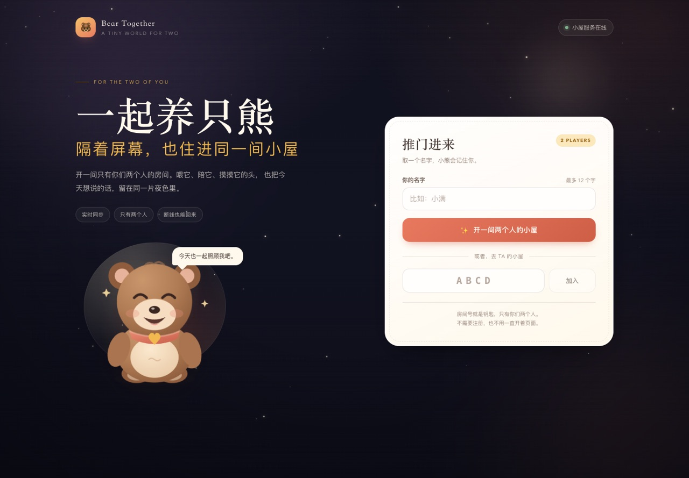
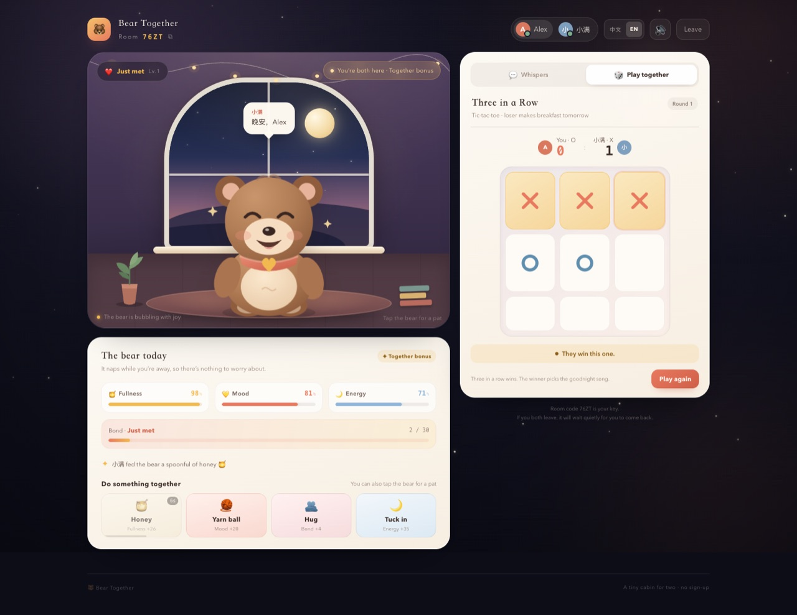

# 🐻 一起养只熊 · Bear Together

> 隔着屏幕，也住进同一间小屋。
>
> 一个只有两个人在线的共同养熊小游戏：一起喂它、陪它玩、摸摸它的头，顺便说几句悄悄话，或者下一盘井字棋。

**在线玩：** <https://bear-together.onrender.com>  
（Render 免费档，第一次打开可能需要等几十秒；两个人重新开一间房即可。）





## 这是什么

我从原来的单机养成原型（喂食、商店、休息、升级）改成了一个 **双人实时联机** 的小屋：

- 两个人用同一个 **4 位房间号** 进入同一间小屋；
- 小熊的饱腹、心情、精力、亲密度由服务端统一计算，两个屏幕同步；
- 可以一起照顾小熊、发快捷表情、聊悄悄话；
- 还有一个双人井字棋，带比分和轮换先手；
- 断线 / 刷新后会自动回到原来的座位。

整个项目只有一个 Node 进程 + 一个 WebSocket 服务，不依赖数据库，适合自己部署或者临时开隧道和 TA 玩。

## 功能

| 功能 | 说明 |
| --- | --- |
| 双人房间 | 创建 4 位房间号，最多两个座位，第三人会被拒绝 |
| 共同养熊 | 喂蜂蜜、玩毛线、抱一抱、哄睡；点击小熊还能摸摸头 |
| 实时同步 | 所有状态在服务端计算，通过 WebSocket 广播 |
| 亲密度 | 互动和「两个人都在线」都会慢慢增加亲密度，分 5 个等级 |
| 悄悄话 | 文字聊天、6 个快捷表情、聊天气泡会出现在小熊头顶 |
| 井字棋 | 三子连珠、比分、每局轮换先手、再来一局 |
| 断线重连 | token + 房间号存在 localStorage，刷新自动回座；座位保留 5 分钟 |
| 陪伴机制 | 两个人都在线时心情更稳定、亲密度增长；没人时小熊打盹，数值暂停衰减 |
| 移动端 | 手机 / 平板响应式布局，支持触屏 |
| 双语界面 | 每个玩家独立选择中文 / English，自动跟随浏览器语言，随时切换 |
| 语言角 | 中文 HSK 1–6 / 法语 DELF A1–B1、间隔重复、完形填空、发音、自己加卡片和笔记 |
| 分享音乐 | 粘贴网易云链接，聊天里变成一张「正在听」卡片（封面 / 歌名 / 歌手） |
| 背景音 | 顶栏 🎵：雨声 / 篝火 / Lo-fi / 钢琴 / 两首古典，音量可调 |
| 小细节 | 音效开关、房间号一键复制、动作冷却、上线提示、离线提示 |

## 中英文玩家可以同时玩吗？

可以，而且不需要房间统一语言。

- **语言是每个玩家自己的设置**：首次打开会自动跟随浏览器语言（中文浏览器 → 中文，其他 → English），右上角的「中文 / EN」可以随时切换，并记住选择。
- **同一个房间，两个视角**：动作日志、系统提示、按钮、亲密度等级、井字棋文字都由客户端按自己的语言渲染；服务端只保存结构化的 `action` / `event` 数据，不保存某一种语言的文案。
- **聊天保持原文**：玩家名字和聊天内容不会自动翻译。中文玩家可以打中文，英文玩家可以打英文；对方看到的是原文。如果以后想加自动翻译，需要接一个翻译 API（目前没有接）。
- **实测**：同一个房间，一个中文窗口 + 一个英文窗口，建房、喂食、聊天、井字棋、断线重连都正常。

## 快速开始

需要 Node.js **20+**。

```bash
npm install
npm run dev
```

打开 <http://localhost:5173>。`npm run dev` 会同时启动：

- Vite 前端：<http://localhost:5173>
- WebSocket / API 服务：<http://localhost:8787>

### 生产方式运行

```bash
npm run build
npm start
```

打开 <http://localhost:8787>。生产模式下 Node 会同时托管 `dist` 静态页面和 `/ws` WebSocket。

## 怎么和 TA 远程一起玩

> 两个人不在同一个 Wi-Fi 下时，必须让其中一方把服务暴露到公网，或者部署到云上。仅在本机 `localhost` 运行，对方是打不开的。

### 方式一：临时公网隧道（最快，适合今晚就玩）

先在本机把游戏跑起来：

```bash
npm run build
npm start
```

再用 Cloudflare Tunnel 开一个临时公网地址（需要先安装 `cloudflared`）：

```bash
# macOS
brew install cloudflared

# 保持 npm start 运行，另开一个终端：
cloudflared tunnel --url http://localhost:8787
```

终端会输出一个 `https://xxxx.trycloudflare.com` 地址，把它和房间号一起发给 TA 即可。

也可以用 ngrok：

```bash
ngrok http 8787
```

注意：

- 隧道开着的时候，任何拿到链接的人都能访问大厅；房间本身有 4 位房间号，且最多两个人。
- 不要把房间号发到公开群聊里。
- 关闭终端后链接就失效了。

### 方式二：部署到 Render（推荐，支持 WebSocket）

[](https://render.com/deploy?repo=https://github.com/man-ning-zhang/beargame)

仓库里已经带了 `render.yaml`，点击上面的按钮即可走 Blueprint 部署。当前已经部署好的实例：

**<https://bear-together.onrender.com>**

部署步骤：

1. 如果仓库是 **private**，先在 Render 的 GitHub App 设置里给 `man-ning-zhang/beargame` 授权（Render Dashboard → Account Settings → GitHub → Repository access）；
2. 点击 **Deploy to Render**，确认创建 `bear-together` 这个 Web Service；
3. 等构建完成，打开 Render 给的 `https://bear-together-xxxx.onrender.com`；
4. 以后 push 到 `main` 会自动重新部署（`render.yaml` 默认 `autoDeployTrigger: commit`）。

配置已经写在 `render.yaml` 里：

- Runtime：Node
- Build：`npm ci --include=dev && npm run build`
- Start：`npm start`
- Health check：`/healthz`
- Plan：`free`

**免费档注意**：Render 免费实例在空闲后会休眠，第一次打开要等几十秒；休眠 / 重启 / 重新部署会清空内存里的房间、聊天和棋局。两个人重新开一间房就能继续玩。想长期保留数据，需要加 Render Key Value / Postgres，或者挂一个持久磁盘（付费）。

### 方式三：Docker

```bash
docker build -t bear-together .
docker run -p 8787:8787 bear-together
```

打开 <http://localhost:8787>。

### 方式四：任意支持 WebSocket 的 Node 托管

平台需要满足：

- 能运行一个长期存活的 Node 进程；
- 支持 WebSocket（反向代理要转发 `/ws` 的 Upgrade）；
- 把平台注入的 `PORT` 传给进程（服务端已读取 `process.env.PORT`）。

## 怎么玩

1. 一个人填写名字，点「开一间两个人的小屋」，拿到 4 位房间号；
2. 把房间号 / 链接发给 TA；
3. TA 在首页填名字和房间号，点「加入」；
4. 两个人都在线后，小熊头顶会显示「你们都在 · 陪伴加成中」；
5. 点下面的动作按钮照顾小熊，或者直接点小熊摸摸头；
6. 右侧「悄悄话」聊天，「一起玩」下井字棋。

井字棋规则：X 先手，三子连珠获胜；赢的人负责明天的早餐（UI 是这么说的）。

## 语言角 · Language Corner

右侧第三个标签页是一个小 Anki，**两个人可以各学各的语言**：你在顶部选 `Français`（DELF A1–B1），TA 选 `中文`（HSK 1–6），进度互不干扰。

- **两套词表**：中文是 HSK 2.0 的 1–6 级（150 / 147 / 298 / 598 / 1299 / 2497 个词），法语是 DELF A1–B1（1070 / 459 / 1050 个词），都按词频从常用到少用排；
- **每天学多少你说了算**：底部「每天新词」可以选 10 / 20 / 50 / 不限；
- **间隔重复**：每张卡可以选「再来一次 / 有点难 / 记住了」，服务器按 SM-2 的简化版安排下次出现时间，按钮上会直接写「3 天后」；
- **点一点听发音**：用浏览器自带的语音（`speechSynthesis`，中文 `zh-CN` / 法语 `fr-FR`），不需要联网、不用下载音频；右上角的音效开关同时管它；
- **笔顺 / 描红**（中文）：卡片右上角的 ✍️ 会打开写字窗——先看一遍笔顺动画（红色是当前这一笔），再切到「自己写」照着轮廓描，写对了自动进入下一笔，写错了会抖一下重来；多字词可以逐字切换；
- **写字模式**（中文）：第四个视图会把当前队列里的词排成一串来练，进去**自动播放笔顺**，写完一个自动跳到下一个，练完 24 个给一句小结；
- **自己的词本**：把聊天里遇到的词加进去，填拼音、意思、备注和标签，标记一下就进入复习队列，并且排在词表新词前面；自建卡按语言分开，中文卡不会混进法语组；
- **完形填空**（中法都有）：中间那个「填空」视图会从例句里挖掉一个词，四选一。中文只挑实词、空在句子中段、且目标词不是更长词的一部分；法语按整词匹配（避免 `ce` 命中 `commence`），冠词和介词也保留，因为那正是法语要练的；答对按「记住了」排期，答错立刻重来；
- **笔记**：词本同时是笔记，支持搜索（字 / 拼音 / 意思 / 备注 / 标签）、编辑、删除；
- **两个人各自的进度**：词表和进度都是每个人自己的，对方只能看到「TA 今天学了 8 个」这种一行摘要；两个人都完成当天目标时，小熊的亲密度会涨一点。

数据和许可：

- **中文词表**：<https://github.com/clem109/hsk-vocabulary>（词表 + 规范读音）+
  <https://github.com/drkameleon/complete-hsk-vocabulary>（释义 / 词性 / 词频，MIT）
- **中法例句**：<https://tatoeba.org>（CC BY 2.0 FR），中文繁体句子用 OpenCC 转成简体
- **法语分级**：FLELex（Cental, UCLouvain），CEFR 分级词频
- **法英释义**：FreeDict `fra-eng`（GPL v2+）
- **汉字笔顺**：<https://github.com/chanind/hanzi-writer>（MIT）+ `hanzi-writer-data`
  （数据来自 <https://github.com/skishore/makemeahanzi>，Arphic Public License）

重新生成：`npm run data:hsk` → `npm run data:examples` → `npm run data:french`，
输出到 `server/data/`，中文词库许可见 `server/data/LICENSE-hsk.txt`。
法语只做 A1–B1：B2 有 4789 个词条，但法英词典只覆盖 34%，做出来大半是空卡。

## 背景音

顶栏的 🎵 打开收音机，七个台，音量默认 45%（可调）：

- **环境**：安静 / 雨声 / 篝火 —— Web Audio 实时合成
- **合成**：Lo-fi Jazz / 温柔钢琴 —— 实时生成的鼓、贝斯、和弦
- **古典**：Satie《吉诺佩蒂》/ Mozart K.330 第三乐章 —— 公有领域录音

切换时会把旧的音符和音频一起停掉（并做 0.12 秒淡出），不会两层声音叠在一起。

**为什么没有宫崎骏**：久石让的作品还在版权保护期内，任何"内置播放"都是侵权。
想要的其实是那种温柔钢琴的气质，所以我写了一版原创的钢琴合成当替代——不是原曲，
也不假装是。

古典录音来自 Wikimedia Commons（Satie 由 Michael Laucke 演奏，Mozart 由 Vadim
Chaimovich / Musopen 演奏），都是公有领域，转成 96 kbps AAC 放在 `public/music/`。

## 分享音乐

把网易云的分享链接（`music.163.com/song?id=…`、`y.music.163.com/m/song?id=…`、
`#/playlist?id=…`、`album/…`）粘进悄悄话，消息会自动变成一张卡片：封面、歌名、歌手，
点一下跳去网易云播放。

- 为什么不在页面里直接播：网易云没有公开的播放接口，它的外链播放器经常因为版权 / 登录态
  拒绝播放，所以卡片以「去网易云听」为主，稳定得多；
- 服务端 `/api/music` 只是查一下歌名和封面（`music.163.com` 的公开详情接口），
  结果缓存一小时，不碰任何账号；
- `163cn.tv` 短链暂时不解析，会当普通链接显示。

## 部署

线上是 Render 的免费实例（<https://bear-together.onrender.com>）。自动部署有两种接法：

1. **Render 自带**：服务 Settings → **Auto-Deploy** 选 **On Commit**（免费版也有；
   如果那一栏根本没出现，说明仓库是用「Public Git repository」网址连的，
   要改成 GitHub App 连接才会出现）
2. **GitHub Action 兜底**：`.github/workflows/deploy.yml` 会在 push 到 main 时跑测试并
   `curl` 一下 Render 的 Deploy Hook。只需要在 GitHub 仓库
   Settings → Secrets and variables → Actions 里加一个 `RENDER_DEPLOY_HOOK_URL`
   （值从 Render → 服务 → Settings → Deploy Hook 复制）。

## 房间号和数据会丢吗

不会因为一次部署就丢掉房间号，也不会丢掉你自己的词本：

- **房间号是永久的住址**：打开 `/?room=7WLQ` 时如果服务端已经没有这间房（重新部署、免费档休眠、12 小时空置回收），会**用同一个号码当场重新点亮**，而不是把人弹回大厅。页面会提示「小屋重新点亮了，房间号没变」，聊天里也会留一条系统消息。
- **你自己的东西存在你自己的浏览器里**：学习进度、词表进度、自建卡片和笔记都保存在 `localStorage`（`bearTogether.personal`），每次进入房间时自动推回服务端，服务端只保留「较新的那一份」。所以重新部署不会清空它们。
- **代价**：换浏览器 / 清空站点数据会丢；两台设备同时用时以最后打开的那一台为准。
- **小熊本身、聊天记录和棋局仍然是内存里的**（这是刻意的：它们是「当下」的东西）。重启后小熊会重新等你们，房间号、词本和进度都还在。

## 设计说明

- **服务端权威**：所有数值、冷却、棋局都在 `server/game.js` 里计算，前端只渲染快照，避免两个人各算一套导致不同步。
- **没人时不掉状态**：只有至少一个人在线时小熊才会饿 / 累；两个人都离开后房间进入打盹状态，避免回来看到一只饿坏的小熊。
- **重连优先于踢人**：刷新页面会用同一个 token 回到原座位；真正的「离开」按钮才会释放座位。
- **房间码即钥匙**：没有账号系统，4 位房间号 + 两个座位。适合情侣 / 朋友，不适合存放敏感内容。
- **双语在客户端完成**：服务端只存 `action` / `event` 这类结构化数据，前端根据每个玩家的语言翻译；因此同一个房间可以一边中文一边 English，聊天内容保持原文。
- **数据在内存里**：房间、聊天、棋局、亲密度都在 Node 进程内存中。重启服务会清空；房间空置 12 小时后自动回收，但同一个房间号可以随时重新点亮。
- **个人数据放在浏览器**：词表进度、自建卡片、笔记由客户端持有主副本（localStorage），进房时同步给服务端；服务端只做校验和「较新者胜」的合并，所以不需要数据库也能扛住反复部署。

## 脚本

| 命令 | 做了什么 |
| --- | --- |
| `npm run dev` | 同时启动 Node 服务和 Vite 前端 |
| `npm run dev:client` | 只启动 Vite 前端（需要另开 `npm run server`） |
| `npm run server` | 只启动 Node 服务（`--watch` 自动重启） |
| `npm run build` | 构建前端到 `dist/` |
| `npm start` | 生产模式：Node 托管 `dist` + WebSocket |
| `npm test` | 服务端房间 / 小熊 / 井字棋 / 间隔重复单元测试 |
| `npm run data:hsk` | 从开源 HSK 词库重新生成 `server/data/hsk.json` |
| `npm run data:examples` | 从 Tatoeba 给中文词库补例句（完形填空用） |
| `npm run data:examples -- --lang fr` | 同上，给法语词库补例句 |
| `npm run data:french` | 生成法语 DELF A1–B1 词库（FLELex + FreeDict） |
| `npm run lint` | ESLint 检查前端和服务端 |
| `npm run preview` | Vite 预览构建结果（不含 WebSocket，不建议用来联机） |

## 目录

```text
.
├── server/
│   ├── index.js        # HTTP 静态服务 + WebSocket 房间网关
│   ├── game.js         # 纯逻辑：房间、小熊数值、聊天、井字棋、个人数据
│   ├── study.js        # 间隔重复：词表、队列、调度
│   ├── notebook.js     # 词本 / 自建卡片的校验与增删改
│   ├── data/           # hsk.json / french.json（生成物）+ 词库许可
│   └── *.test.js       # node:test 单元测试
├── src/
│   ├── components/     # Bear / Scene / CarePanel / ChatPanel / GamePanel / StudyPanel / ClozePanel / NotebookPanel ...
│   ├── context/        # RoomContext + LanguageContext
│   ├── i18n.js         # 中文 / English 文案与语言检测
│   ├── pages/          # Lobby / RoomPage
│   ├── utils/          # sound.js 音效 · speech.js 中文发音
│   ├── gameConfig.js
│   ├── theme.js
│   └── index.css
├── scripts/dev.mjs     # 一条命令同时跑前后端
├── docs/               # README 截图
├── Dockerfile
├── render.yaml
└── vite.config.js      # 开发时把 /ws 代理到 8787
```

## 测试

```bash
npm test        # 10 个服务端逻辑测试
npm run lint
npm run build
```

服务端测试覆盖：座位分配、重连、满房拒绝、动作效果与冷却、数值衰减与暂停、井字棋胜负 / 平局 / 换先手、聊天限流、快照不泄露 token、间隔重复调度与每日上限、完形填空出题与判分、中法两套词表与语言切换、自建卡片、个人数据合并与脏数据过滤。

## 已知限制 / 还可以加什么

- 房间的共享状态（小熊、聊天、棋局）只在内存里，重启会重来；个人词本和进度靠浏览器保存；
- 换设备就看不到原来的词本；想跨设备可以加 SQLite / Redis / 免费 KV；
- 没有账号，房间码就是唯一凭证；
- 聊天不会自动翻译，显示的是对方输入的原文；需要自动翻译的话要接翻译 API；
- 目前只有一个实时小游戏（井字棋），后面可以加你画我猜、双人翻牌、合作接星星；
- 可以加一个「共同日记」：每天留一句话，第二天对方进来才能看到；
- 可以做成 PWA，手机上像 App 一样打开；
- 如果想要更省服务器，可以改成 WebRTC 点对点，但仍然需要一个信令服务。

---

为两个人做的小屋。祝你们玩得开心。🐻
